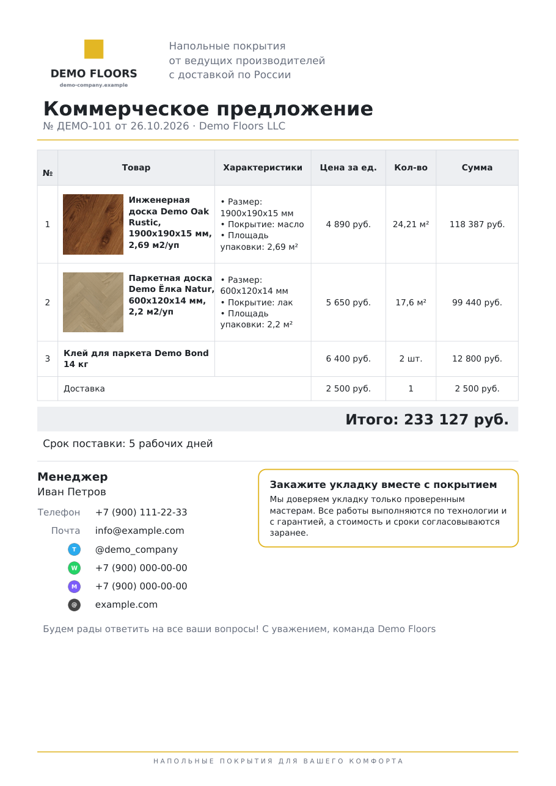
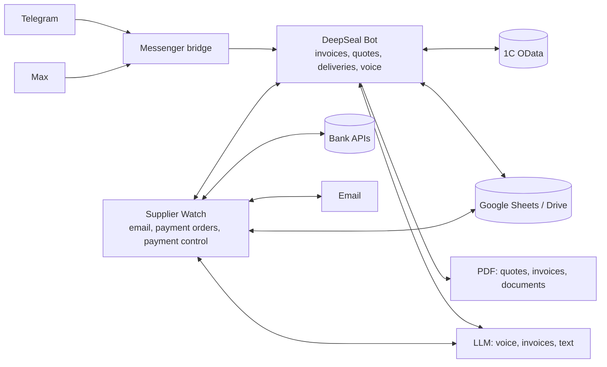

# DeepSeal — Sales Team Assistant for Telegram and Max

**[Русская версия](README.md)**

An internal system for an online flooring store. Managers run a deal from a messenger, by text or voice: a quote (KP) for the client, an invoice in 1C (a Russian ERP), a supplier request, delivery and the driver's documents. Payment reconciliation, payment orders and task tracking run in the background. The bot works in Telegram and in Max (a Russian messenger) with the same features and a shared database. Up to 25 people use it daily: managers, accountants, drivers and directors.

> **This is a project showcase.** The production code is private: it contains company details, the client base and bank integrations. This repository describes the goals, architecture and results, and includes a few standalone modules (PDF quote generator, package calculation, payment purpose) with tests and fictional data.



## Problem

- 1C is slow and inconvenient to reach from home or after hours.
- Quotes were assembled by hand in Google Sheets, each manager in their own style, with no shared base.
- Supplier invoices arrive by email; someone had to enter them into the payments sheet, the accountant had to type a payment order for each one, then set the status and send it to the supplier.
- Driver documents (waybills, TORG-12, UPD) were printed one by one for each delivery.
- There was no systematic check that an invoice was fully paid before shipping; discrepancies surfaced at shipment.
- Tasks in work chats got lost.

## Results

| Process | Before | After |
|---|---|---|
| Quote for a client | 15 min | **2.5 min**, a consistent branded PDF |
| Invoice in 1C | 9.5 min | **3.5 min**, from anywhere |
| Supplier payment orders | typed by the accountant | **~40 per day** created and sent automatically |
| Payment reconciliation | manual, up to 1 hour a day | automatic, reported before shipping |

- Deal progression to the next AmoCRM pipeline stage grew by **37%** compared with the previous period.
- The payment control service has caught **₽800k** of payment discrepancies before shipment.

## Architecture



## Design decisions

- **One codebase, two messengers.** Max messages are converted into the same events as Telegram; replies go back where the request came from.
- **Money goes through a human.** The bot only creates draft payment orders; a person signs them. Duplicate protection and an action log.
- **1C documents start as drafts** and are posted as a separate step.
- **Graceful degradation.** If a bank, 1C or a sheet is unavailable, reconciliation uses the remaining sources and the report shows what was missing.
- **Most expensive manual work first.** Quotes and invoices first (most daily time), then payment reconciliation (risk of money errors). Each feature shipped as a minimal version and was refined from staff feedback.

## Engineering highlights

| Problem | Solution |
|---|---|
| Card acquiring lands as one daily sum covering several invoices, sometimes shifted by weekends. | Subset matching of payments to the daily sum (meet-in-the-middle), tolerances for fees and rounding, a ±1–3 business-day window. |
| The sheet says "cash" but the client paid by QR to another company. | The stated method is only the first hypothesis; otherwise the payment is searched in all cash desks, statements and deliveries and flagged "found elsewhere". |
| A quote with any number of products and photos must fit on one page. | Layouts per item count and a scale ladder that shrinks the layout step by step ([kp_pdf.py](src/deepseal/kp_pdf.py)). |
| Quantities must be multiples of packages, with cutting allowance and no extra package due to rounding noise. | A 0.09-package tolerance and a 0.5-unit step for goods sold in halves ([quantity.py](src/deepseal/quantity.py)). |

## In this repository

```bash
pip install -r requirements.txt
python examples/make_demo_kp.py   # quotes appear in output/
pytest -q                         # 14 tests
```

`src/deepseal/` holds the quote generator, package calculation and payment purpose rules; `examples/` builds sample quotes from fictional data; `docs/` has PNG and PDF samples. Bot dialogs, integrations and company data are not included. Floor photos in `examples/photos` are catalogue samples used for the demo; product names are fictional.

## Stack

Python, pyTelegramBotAPI, Max Bot API, 1C OData, Google Sheets / Drive / Gmail API, bank APIs, LLM (DeepSeek) and speech-to-text, SQLite, ReportLab, Pillow, PyMuPDF, Docker, pytest, GitHub Actions.

## My role

The project started with a request from management: optimise internal processes, cut routine work and take load off the managers so they have more time for sales and a calmer working day. There was no ready specification. I analysed how the company works — how managers, accounting, drivers and the director interact, and where time and money are lost — and on that basis designed the bot's logic around the staff's real tasks, set priorities, built and rolled out the solutions. I continue to maintain and develop the system based on feedback and usage statistics.

## License

Code in this repository is MIT, see [LICENSE](LICENSE). DejaVu fonts in `src/deepseal/assets` are under the DejaVu / Bitstream Vera license.
