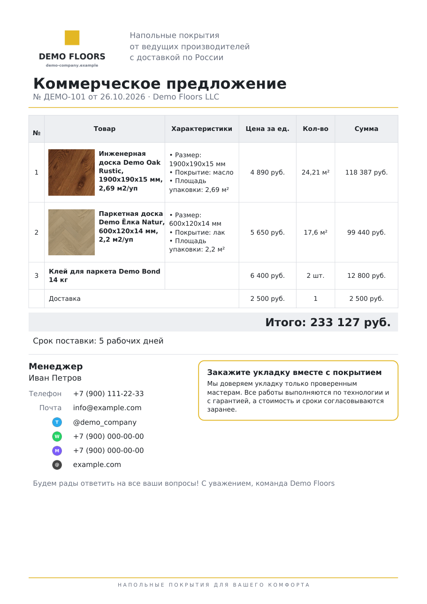
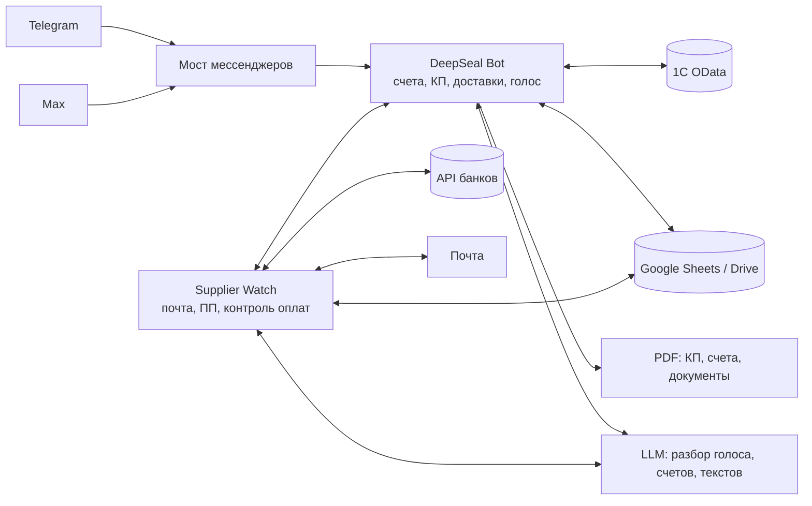
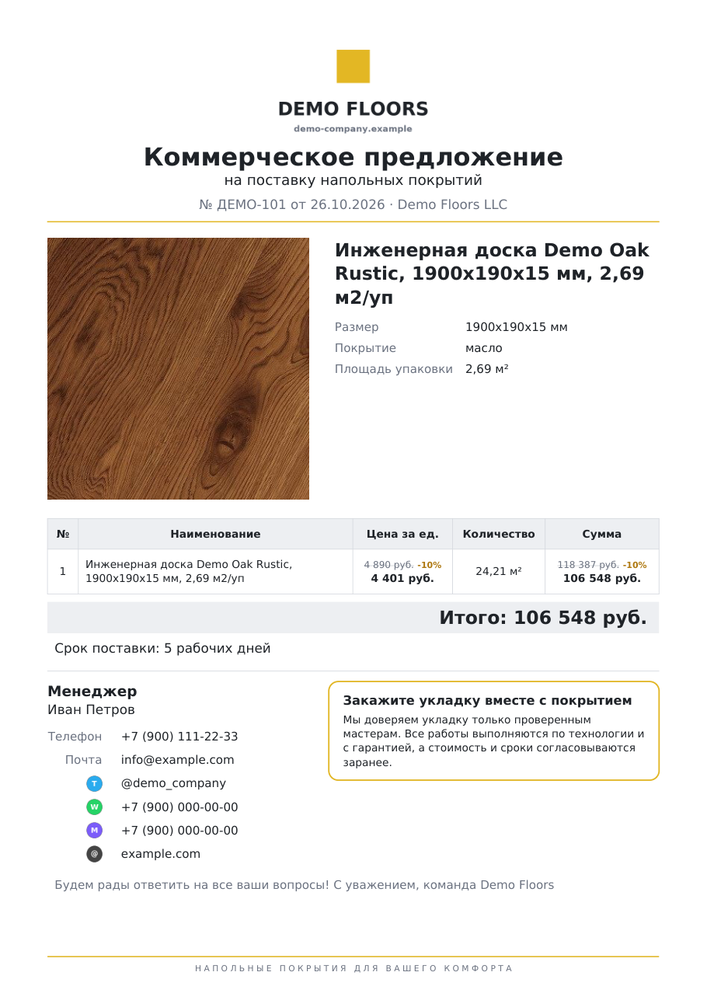
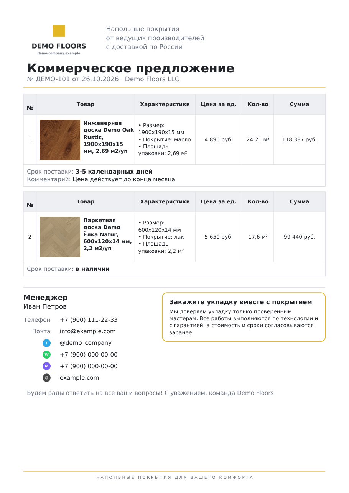

# DeepSeal — ассистент отдела продаж в Telegram и Max

**[English version](README.en.md)**

Внутренняя система интернет-магазина напольных покрытий. Менеджер ведёт сделку в мессенджере, текстом или голосом: КП клиенту, счёт в 1С, запрос поставщику, доставка, документы водителю. Сверка оплат, платёжные поручения и контроль задач работают в фоне. Бот работает в Telegram и в Max с одинаковыми функциями и общей базой. Им ежедневно пользуются до 25 человек: менеджеры, бухгалтеры, водители, директора.

> **Это витрина проекта.** Код боевой системы закрыт: в нём реквизиты, клиентская база и интеграции с банками. Здесь описаны задачи, архитектура и результаты, а также выложены несколько самостоятельных модулей (генератор КП в PDF, расчёт упаковок, назначение платежа) с тестами и вымышленными данными.




## Задача

Работа отдела держалась на ручном труде в нескольких системах:

| Проблема | Как было |
|---|---|
| Медленная 1С | Любое действие в 1С занимает время, а из дома или в нерабочее время доступ к ней неудобен. |
| КП | Собирались вручную в Google-таблице, у каждого менеджера свой вид, общей базы нет. |
| Много таблиц | У каждого менеджера своя вкладка; оплаты, кассы и доставки вносятся руками. |
| Счета поставщиков | Приходят менеджеру на почту. Их нужно внести в таблицу оплат, бухгалтеру — набить платёжное поручение (ПП), потом проставить статус и отправить ПП поставщику. |
| Документы водителю | Накладные, ТОРГ-12 и УПД по каждой доставке печатаются по одной. |
| Оплаты перед отгрузкой | Не было системной проверки, что счёт оплачен полностью и цифры не поправили задним числом. Расхождения находились при отгрузке. |
| Задачи | Поручения в рабочих чатах терялись. |

## Результат

| Процесс | Было | Стало |
|---|---|---|
| КП клиенту | 15 мин | **2,5 мин**, единый оформленный PDF |
| Счёт в 1С | 9,5 мин | **3,5 мин**, из любого места |
| Платёжные поручения поставщикам | вручную бухгалтером | **~40 ПП в день** создаются и отправляются автоматически |
| Сверка оплат | вручную, до 1 часа в день у бухгалтера | автоматически, с отчётом до отгрузки |

- Переход сделок на следующий этап воронки amoCRM вырос на **37%** относительно предыдущего периода: КП подстраиваются под задачу менеджера и аккуратно оформлены.
- За время работы сервиса контроля оплат до отгрузки найдены расхождения на **800 тыс. ₽**.

## Что умеет

**Счета и 1С**
- Счёт в 1С из диалога: фирма, клиент, позиции по ссылке с сайта, количество кратно упаковкам с запасом на подрезку, скидки, доставка. Правка и удаление счёта самим менеджером.
- PDF счёта с QR-кодом для оплаты по ГОСТ Р 56042-2014 (три юрлица, свои шаблоны).
- Реализация по счёту в 1С: черновик, проведение, накладная / ТОРГ-12 / УПД.
- Поиск счёта по телефону клиента, занесение счёта в таблицу менеджера.

**Коммерческие предложения**
- КП по ссылке на товар или названию: фото и характеристики с сайта, расчёт площади и упаковок.
- Несколько товаров, выбор и загрузка фото, скидки на позицию и на всё КП, режим «без общей суммы» со своим сроком на каждую позицию. Всё помещается на одну страницу.
- База КП всех менеджеров: поиск по номеру и товару, правка, передача КП другому менеджеру.

**Голосовые команды**
- «Выставь счёт на 20 м² ламината», «уточни наличие у поставщика»: речь распознаётся, LLM разбирает намерение и параметры, бот проводит по тому же сценарию, что и кнопки.

**Поставщики и платёжные поручения**
- Запросы поставщикам (счёт, наличие, защита заказа) по ссылке с сайта.
- Слежение за почтой: счёт поставщика пришёл → распознан → внесён в таблицу оплат → в банке создан черновик ПП → после оплаты проставлен статус, ПП уходит менеджеру и по кнопке поставщику.

**Доставки**
- План доставок на день, назначение водителей, расчёт денег, которые водитель берёт с клиента.
- Документы дня для водителя одним PDF, заявки поставщикам на забор груза.

**Контроль оплат перед отгрузкой**
- Ежедневно загружаются выписки трёх банковских счетов, кассы магазинов и данные 1С.
- Каждый счёт сверяется: оплачен ли полностью и где нашёлся платёж (наличные в кассе, эквайринг общей суммой за день, безнал, QR, оплата водителю). Отдельно ловятся правки задним числом, дубли и опечатки в суммах.
- Вечером — проверка доставок на завтра с отчётом директору, список недоплат и ошибок с кнопкой «решено».

## Архитектура



Docker-сервисы на одном VPS: бот и сервис слежения обмениваются уведомлениями и командами через общую SQLite-базу.

## Почему так устроено

- **Один код для двух мессенджеров.** Сообщения Max переводятся в те же события, что и в Telegram, ответы уходят туда, откуда пришёл запрос. Логика сценариев не дублируется, база сотрудников и КП общая.
- **Деньги — только через человека.** Бот создаёт черновики ПП, подписывает их бухгалтер или директор. Защита от повторного ПП по тому же счёту, журнал действий.
- **Документы в 1С — сначала черновик.** Реализация создаётся черновиком и проводится отдельным действием, чтобы ошибка в диалоге не попадала в учёт.
- **Мягкая деградация.** Если какой-то источник (банк, 1С, таблица) недоступен, сверка идёт по остальным, а в отчёте видно, чего не хватило.
- **Сначала самые дорогие ручные операции.** Первыми автоматизированы КП и счета (больше всего ежедневного времени), затем сверка оплат (риск денежных ошибок). Каждая функция запускалась минимальной версией и дорабатывалась по замечаниям сотрудников.

## Интересные инженерные задачи

| Проблема | Решение |
|---|---|
| Эквайринг приходит на счёт одной суммой за день, а за ней стоят несколько счетов разных менеджеров, иногда со сдвигом на выходные. | Подбор комбинации платежей под дневную сумму («встреча посередине» по подмножествам), допуски на комиссию и округления, окно ±1–3 рабочих дня. |
| Менеджер указал в таблице «наличные», а клиент заплатил QR на другую фирму. | Указанный способ — только первая гипотеза. Если подтверждения нет, платёж ищется во всех кассах, выписках и доставках, а в отчёте помечается «найдено не там, где указано». |
| КП с разным числом товаров и фото должно помещаться на одну страницу. | Разные раскладки под число позиций и лесенка масштабов: вёрстка уменьшается шагами, пока не встанет на страницу ([kp_pdf.py](src/deepseal/kp_pdf.py)). |
| В назначении платежа поставщику нужно правильно назвать товар («за ламинат и подложку»), а названия позиций длинные и смешанные. | Правило по предметной области: побеждает покрытие, названное раньше всех, сопутствующее идёт после, подложка — последней ([payment_purpose.py](src/deepseal/payment_purpose.py), с тестами). |
| Количество в счёте и КП должно быть кратно упаковкам, с запасом на подрезку и без лишней упаковки из-за погрешности. | Допуск округления 0,09 упаковки, шаг 0,5 шт для товаров, которые продают половинками ([quantity.py](src/deepseal/quantity.py)). |

## Что в этом репозитории

| Путь | Что это |
|---|---|
| [`src/deepseal/kp_pdf.py`](src/deepseal/kp_pdf.py) | Генератор КП в PDF на ReportLab: один и несколько товаров, скидки, «без общей суммы», автоподбор масштаба |
| [`src/deepseal/quantity.py`](src/deepseal/quantity.py) | Площадь → упаковки с запасом, допуск округления, шаг 0,5 шт |
| [`src/deepseal/payment_purpose.py`](src/deepseal/payment_purpose.py) | Назначение платежа по позициям счёта поставщика |
| [`tests/`](tests) | 14 тестов (pytest, GitHub Actions на каждый push) |
| [`examples/make_demo_kp.py`](examples/make_demo_kp.py) | Собирает примеры КП из вымышленных данных |
| [`docs/`](docs) | Примеры КП: PNG и [PDF](docs/sample_kp.pdf) |

Не вошло: диалоги бота, интеграции с 1С, банками, почтой и сайтом, данные компании. Логотип и значки в `assets` нейтральные демо-версии; фото покрытий в `examples/photos` взяты из каталога для демонстрации, названия товаров вымышленные.

```bash
pip install -r requirements.txt
python examples/make_demo_kp.py   # КП появятся в output/
pytest -q
```

| Скидка на позицию | Режим «без общей суммы» |
|---|---|
|  |  |

## Стек

Python, pyTelegramBotAPI, Max Bot API, 1С OData, Google Sheets / Drive / Gmail API, API банков, LLM (DeepSeek) и Speech-to-Text, SQLite, ReportLab, Pillow, PyMuPDF, Docker, pytest, GitHub Actions.

## Моя роль

Проект начался с запроса руководства: оптимизировать внутренние процессы, убрать рутину и разгрузить менеджеров, чтобы у них оставалось больше времени на продажи, а работа шла спокойнее. Готового ТЗ не было. Я разобрал, как устроена работа компании: как взаимодействуют менеджеры, бухгалтерия, водители и директор, где теряется время и появляются денежные ошибки. По этому анализу спроектировал логику бота под реальные задачи сотрудников, расставил приоритеты, реализовал и внедрил решения. Сейчас поддерживаю систему и развиваю её по обратной связи и статистике использования.

## Лицензия

Код в этом репозитории — MIT, см. [LICENSE](LICENSE). Шрифты DejaVu в `src/deepseal/assets` распространяются по лицензии DejaVu / Bitstream Vera.
